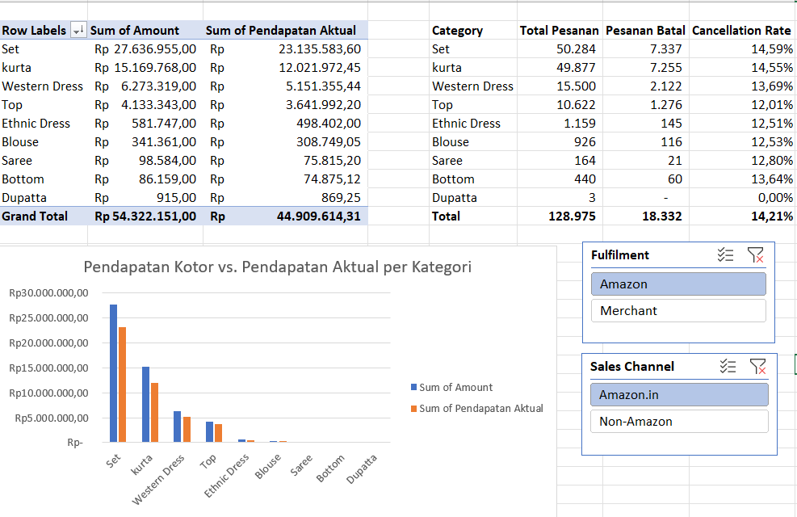

# 📊 Amazon India Retail Sales & Cancellation Rate Analysis

Analisis data transaksi ritel **Amazon India** (`Amazon.in` & `Non-Amazon`) sebanyak **128.975 baris pesanan** menggunakan Microsoft Excel. Proyek ini berfokus pada pembersihan data, pemodelan pendapatan bersih (*Net Revenue*) setelah diskon dan pembatalan, audit tingkat pembatalan (*Cancellation Rate*) per kategori, serta pembuatan *mini-dashboard* interaktif.

---

## 📌 Ringkasan Metrik Utama (*KPI Snapshot*)

| Metrik Utama | Nilai | Keterangan |
| :--- | :---: | :--- |
| **Total Volume Pesanan** | `128.975` | Seluruh transaksi lintas 9 kategori produk |
| **Pendapatan Kotor (*Gross Amount*)** | `Rp 78.592.678,30` | Total nilai pesanan sebelum filter pembatalan & diskon |
| **Pendapatan Aktual (*Net Revenue*)** | `Rp 63.587.977,46` | Pendapatan bersih terealisasi dari pesanan aktif setelah diskon |
| **Selisih / Kebocoran Pendapatan** | `Rp 15.004.700,84` | Terkoreksi **19,09%** akibat pesanan `Cancelled` & potongan promo |
| **Total Pesanan Batal** | `18.332` | Rata-rata *Cancellation Rate* keseluruhan sebesar **14,21%** |

---

## 💡 Rincian Temuan Bisnis (*Business Insights*) & Rekomendasi

### 1. Kebocoran Pendapatan Hampir Mencapai 20%
* **Temuan:** Dari total pendapatan kotor sebesar **Rp 78.592.678,30**, perusahaan hanya merealisasikan pendapatan bersih sebesar **Rp 63.587.977,46**. Sebanyak **Rp 15.004.700,84 (19,09%)** hilang karena transaksi yang dibatalkan serta pemberian diskon kategori.
* **Rekomendasi:** Memisahkan pelaporan *Gross Revenue* dan *Net Revenue* secara rutin agar tim keuangan dan operasional tidak mengalami *overestimation* dalam memproyeksikan arus kas masuk.

### 2. Dominasi Pendapatan pada Dua Kategori Utama (Pareto Effect)
* **Temuan:** Kategori **Set** (`Rp 32.158.505,70`) dan **kurta** (`Rp 16.511.989,50`) menyumbang gabungan pendapatan aktual sebesar **Rp 48.670.495,20** atau **76,54%** dari seluruh pendapatan bersih bisnis. Kategori **Western Dress** berada di posisi ketiga dengan kontribusi **Rp 8.984.439,20 (14,13%)**.
* **Rekomendasi:** Memprioritaskan ketersediaan stok (*safety stock*) dan alokasi anggaran promosi utama pada kategori **Set** dan **kurta** sebagai mesin utama pendapatan.

### 3. Titik Kritis Pembatalan Pesanan (*Cancellation Bottleneck*)
* **Temuan:** Tingkat pembatalan rata-rata berada di angka **14,21%** (`18.332` dari `128.975` pesanan). Kategori **Set** memiliki rasio pembatalan tertinggi sebesar **14,59%** (`7.337` batal), disusul **kurta** sebesar **14,55%** (`7.255` batal), dan **Western Dress** sebesar **13,69%** (`2.122` batal). Secara volume, **Set** dan **kurta** menyumbang **79,60%** dari total seluruh pembatalan pesanan. Sementara itu, kategori **Top** memiliki performa retensi pesanan paling stabil dengan *cancellation rate* terendah sebesar **12,01%**.
* **Rekomendasi:** Melakukan audit operasional khusus pada pemenuhan pesanan (*fulfilment*) dan akurasi deskripsi ukuran/stok untuk produk **Set** dan **kurta**. Menurunkan *cancellation rate* pada dua kategori ini sebesar 2–3% saja akan berdampak signifikan pada pemulihan pendapatan bersih.

## 🛠️ Tabel Rumus & Metodologi Analisis Excel

| Tahapan Analisis | Fungsi / Fitur Excel | Sintaks Rumus yang Digunakan | Penjelasan Logika Implementasi |
| :--- | :--- | :--- | :--- |
| **Pemetaan Diskon Dinamis** | `XLOOKUP` | `=XLOOKUP(J2; MasterDiskon!A:A; MasterDiskon!B:B; 0)` | Mencocokkan kategori produk (`J2`) dengan tabel referensi di sheet `MasterDiskon` untuk menarik persentase diskon otomatis (mengembalikan `0` jika kategori tidak termasuk promo). |
| **Kalkulasi Pendapatan Bersih** | `IF` | `=IF(D2="Cancelled"; 0; P2*(1-Z2))` | Mengevaluasi status pesanan (`D2`); jika berstatus `"Cancelled"` nilainya menjadi `0`, sedangkan pesanan aktif dikalikan dengan `(1 - Diskon)` untuk mendapatkan nilai bersih. |
| **Kontrol Kualitas Audit** | `Data Validation` | *List:* `Selesai; Pending` | Membatasi input kolom status pengecekan menggunakan *dropdown list* guna mencegah kesalahan pengetikan (*typo*) saat audit data manual. |
| **Hitung Total Pesanan** | `COUNTIF` | `=COUNTIF('Amazon Sale Report'!$J:$J; E4)` | Menghitung total frekuensi transaksi untuk masing-masing kategori produk (`E4`) di seluruh 128.975 baris dataset. |
| **Hitung Pesanan Batal** | `COUNTIFS` | `=COUNTIFS('Amazon Sale Report'!$J:$J; E4; 'Amazon Sale Report'!$D:$D; "Cancelled")` | Menghitung jumlah pesanan yang gagal/batal berdasarkan dua kriteria sekaligus: nama kategori (`E4`) dan status `"Cancelled"`. |
| **Rasio Pembatalan** | *Arithmetic Formula* | `=G4/F4` | Membagi jumlah pesanan batal (`G4`) dengan total pesanan (`F4`) untuk memperoleh persentase *Cancellation Rate* presisi dua desimal. |
| **Agregasi & Visualisasi** | `Pivot Table`, `Pivot Chart`, `Slicers` | *Filter:* `Fulfilment`, `Sales Channel` | Meringkas perbandingan pendapatan kotor vs. aktual dalam grafik batang interaktif yang dapat difilter berdasarkan jalur pengiriman (`Amazon` vs `Merchant`) dan kanal penjualan. |

---

## 📁 Struktur File Repository

* **`Amazon Sale Report.xlsx`** — File kerja utama Microsoft Excel berisi dataset transaksi bersih (`Amazon Sale Report`), tabel skema diskon (`MasterDiskon`), serta laporan ringkasan dan *mini-dashboard* (`Pivot Table`).
* **`dashboard-preview.png`** — Tangkapan layar visualisasi akhir *Pivot Table*, tabel audit *Cancellation Rate*, *Pivot Chart*, dan *Slicers*.
* **`README.md`** — Dokumentasi metodologi, rumus Excel, dan ringkasan *business insights*.
